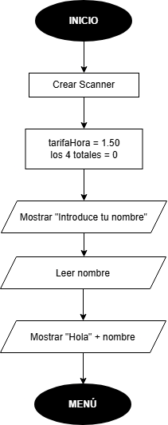
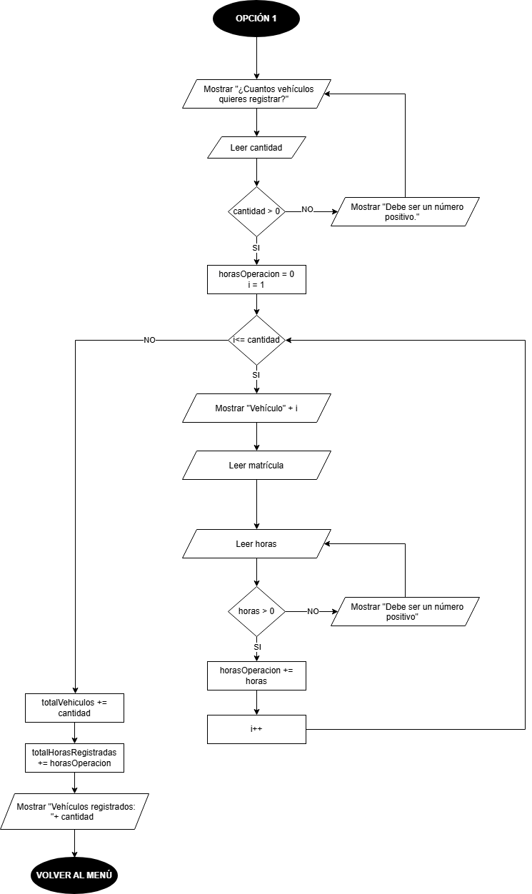
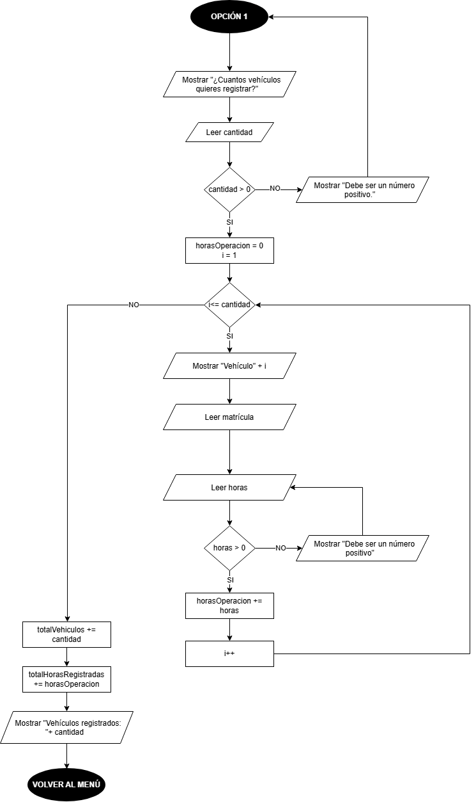
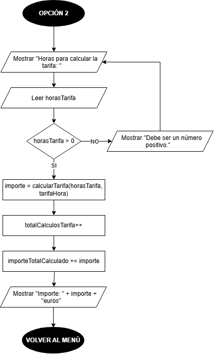
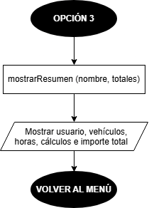
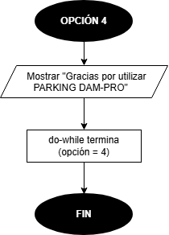

# PARKING DAM-PRO

En este repositorio están las dos actividades del parking de Programación de 1.º de DAM. En la primera diseñé el programa con diagramas de flujo, y en la segunda lo programé en Java.

## 1. Qué hace el programa

Es un programa de consola para un parking. Te pide el nombre y te sale un menú con 4 opciones:

- Registrar vehículos, con su matrícula y las horas que han estado aparcados.
- Calcular lo que cuesta una tarifa, a 1,50 € la hora.
- Ver un resumen de todo lo que llevas hecho.
- Salir.

El menú se va repitiendo hasta que eliges salir.

## 2. Actividad 1: los diagramas

Antes de programar nada hice seis diagramas de flujo en draw.io, uno para cada parte del programa. Están todos en la carpeta diagramas, y el archivo para editarlos es [parking.drawio](diagramas/parking.drawio).

### 2.1. Inicio

Es lo primero que pasa: se crea el Scanner, se ponen los totales a 0 y se pide el nombre.

### 2.2. Menú

El menú se repite con un do-while hasta que eliges la 4. Con una cadena de rombos se mira qué opción has elegido y se va a su diagrama.

### 2.3. Registro de vehículos

Con un for se piden la matrícula y las horas de cada vehículo, y se comprueba que las horas sean mayores que 0.

### 2.4. Tarifa

Se piden las horas, se multiplican por 1,50 y se suma el importe al total.

### 2.5. Resumen

Se enseñan todos los totales que llevas en la sesión.

### 2.6. Salida

Sale la despedida, se cierra el Scanner y se acaba el programa.

## 3. Implementación Java

En la segunda actividad pasé estos diagramas a un programa Java con Maven. Ahora el menú, el registro, la tarifa y el resumen funcionan de verdad, y cada parte está en su propio método.

Al pasarlo a código también corregí dos cosas de los diagramas de ejemplo: la opción 4 volvía al menú en vez de terminar, y el for no tenía rombo para saber cuándo se sale. En los míos ya está arreglado.

Todo lo del programa (los métodos, las pruebas que hice y cómo lo fui subiendo a Git) está explicado en su propio README.